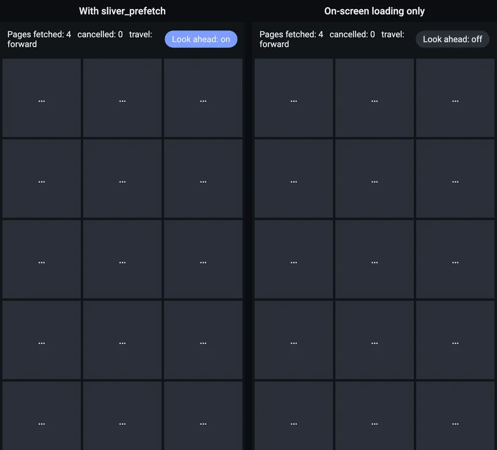

# sliver_prefetch

Know which items of a Flutter list or grid are about to scroll into view, and
which no longer are, so you can preload their data, images or video before the
user gets there. Works with `ListView`, `GridView` and any `SliverList` or
`SliverGrid`, whatever its layout. Modelled on UIKit's
[`UICollectionViewDataSourcePrefetching`](https://developer.apple.com/documentation/uikit/uicollectionviewdatasourceprefetching).



Most Flutter pagination packages answer "the user reached the end, load the
next page", and own your list to do it. This one answers a different question:
*which children are about to be needed?* That suits data whose shape you
already know but whose contents arrive later: a list of ids hydrated in pages,
thumbnails to warm, videos to preload, rows that can be jumped into at any
offset.

## Install

```sh
flutter pub add sliver_prefetch
```

## Usage

```dart
class _GalleryState extends State<Gallery> {
  late final _prefetcher = SliverPrefetcher(
    ahead: const PrefetchExtent.layouts(1),   // one laid-out range ahead
    behind: const PrefetchExtent.items(6),    // a little behind, for turnarounds
    onPrefetch: (indices) => repository.load(indices),
    onCancelPrefetch: (indices) => repository.cancel(indices),
  );

  @override
  void dispose() {
    _prefetcher.dispose();
    super.dispose();
  }

  @override
  Widget build(BuildContext context) => CustomScrollView(
    slivers: [
      SliverGrid(
        gridDelegate: const SliverGridDelegateWithFixedCrossAxisCount(
          crossAxisCount: 3,
        ),
        delegate: PrefetchingSliverChildBuilderDelegate(
          (context, index) => Tile(index),
          childCount: repository.count,
          prefetcher: _prefetcher,
        ),
      ),
    ],
  );
}
```

Using `ListView` or `GridView`? Use their `.custom` constructors and pass the
same delegate as `childrenDelegate`:

```dart
ListView.custom(
  childrenDelegate: PrefetchingSliverChildBuilderDelegate(
    (context, index) => ItemTile(index),
    childCount: repository.count,
    prefetcher: _prefetcher,
  ),
)
```

Have a delegate of your own? Mix in `SliverPrefetchingDelegateMixin` and
provide a `prefetcher` getter.

## Compared with

### Why not raise `cacheExtent`?

A bigger cache extent is the usual way to get ahead of the user, and the
viewport does it by building, laying out and keeping alive every child in
range: the same distance behind as ahead, whichever way the user is going, and
with no signal for when something stops being needed. sliver_prefetch leaves
the cache extent alone and tells your data layer instead, so the widgets come
later and only the data is early.

Both setups below look 2000 px ahead on a three-column grid of 133 px rows in
an 800 px viewport:

| | `cacheExtent: 2000` | sliver_prefetch, 2000 px ahead |
| --- | ---: | ---: |
| Tiles built for the first frame | 63 | 24 |
| Tiles alive while scrolling | 111 | 33 |
| Tiles built in the frame after a jump | 111 | 30 |
| Tiles built per frame of steady scrolling | 1 | 1 |

Steady scrolling costs the same either way. The difference is the bursts and
what stays alive: with a big cache extent, every tile in range, behind you as
well as ahead, holds its widgets, layout and anything it loaded, decoded
images included. The counts come from
[`example/tool/cache_extent_benchmark_test.dart`](example/tool/cache_extent_benchmark_test.dart),
which counts work rather than timing it; how much each tile costs depends on
the tile. sliver_prefetch's own overhead is one small wrapper widget per child
(see [Caveats](#caveats)).

### And the packages?

| | sliver_prefetch | [infinite_scroll_pagination](https://pub.dev/packages/infinite_scroll_pagination) | [visibility_detector](https://pub.dev/packages/visibility_detector) |
| --- | --- | --- | --- |
| Answers | Which items are about to be needed? | Has the user nearly reached the end? | How much of this widget is visible? |
| Sees past built children | ✅ | ❌ triggers as built items near the end | ❌ only built widgets |
| Looks further in the direction of travel | ✅ | — | ❌ |
| Says when an index is no longer needed | ✅ `onCancelPrefetch` | ❌ | Partly: visibility drops to 0 |
| Jump to any position | ✅ | ❌ pages load in order | ✅ |
| Works with your existing list | ✅ swap the delegate | ❌ its own `Paged…` widgets | ✅ wrap each child |
| Loading, error and empty states | ❌ yours to build | ✅ built in | ❌ |

infinite_scroll_pagination is the better fit when items arrive in pages from
the start and you want its loading, error and empty states. The two also work
together: let it append pages, and use sliver_prefetch to fill in each item
(thumbnails, details) before it scrolls in. visibility_detector reports how
visible a built widget is, throttled to every 500 ms by default; its
repository was archived in 2024.

## How it works

`RenderSliverList` and `RenderSliverGrid` call
`SliverChildDelegate.didFinishLayout(firstIndex, lastIndex)` after every
layout with the range of children they built, cache extent included. The
delegate passes that range to the `SliverPrefetcher`, which:

1. infers the direction of travel from how the range moved;
2. computes the window: `ahead` past the leading edge, `behind` past the
   trailing one, clipped to `[0, childCount)`. While the direction holds,
   neither edge moves backwards, so a `layouts` extent, which follows a
   laid-out count that rises and falls by a row as rows come and go, does
   not cancel what is needed a moment later;
3. reports indices that entered the window to `onPrefetch`, nearest first,
   and indices that left it without being laid out to `onCancelPrefetch`;
4. does all of this after the frame, once per frame, because layout is no
   place to mark anything dirty.

Indices that scroll into view are retired silently, as on iOS. An index is
not reported twice while outstanding. Call `invalidate` to report particular
indices again (a fetch failed, say), or `reset` when the data behind the
indices changes.

## Options

| Option | Default | Meaning |
| --- | --- | --- |
| `ahead` | `PrefetchExtent.layouts(1)` | Look-ahead in the direction of travel |
| `behind` | `PrefetchExtent.none` | Look-ahead against it |
| `includeLaidOut` | `false` | Also report laid-out children, for cells that do not load their own data |
| `enabled` | `true` | Pause reporting; re-enabling reports the window afresh |

`PrefetchExtent.items(n)` is a fixed count. `PrefetchExtent.layouts(f)` is a
multiple of however many children are laid out, so it adapts to screen size,
item size and column count on its own.

## Caveats

- **Prefetching is a hint.** Callbacks can name indices that are already
  loaded. Make handlers idempotent.
- **Keep-alives widen the range.** The range comes from the sliver's element
  map, which also holds `AutomaticKeepAlive` children. A kept-alive child far
  off screen stretches the reported range to reach it.
- **One prefetcher per sliver.** It remembers one range, so two slivers
  sharing one overwrite each other's.
- **Only built children are known.** A sliver scrolled wholly past the
  viewport builds nothing, so it reports nothing and keeps what it had asked
  for; when it comes back, the end it reappears at sets the direction. A
  sliver waiting *below* the viewport is different: Flutter builds its first
  child, so its look-ahead starts before it scrolls in.
- **Each child gets a wrapper.** The delegate wraps every child in a small
  stateful widget that carries the child's key, to tell a layout that built
  child 0 from one that built nothing (Flutter reports both as `(0, 0)`).
  Keyed reordering and `findChildIndexCallback` keep working.

## Example

[`example/`](example/lib/main.dart) is a 1,000-cell grid over a repository
that takes 600 ms per page, with a switch to compare prefetching against
loading only what is on screen. The demo above is rendered from it by
[`example/tool/record_demo.sh`](example/tool/record_demo.sh).

## License

BSD 3-Clause. See [LICENSE](LICENSE).
